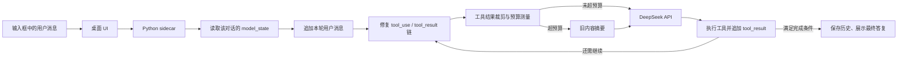

# AstraCode 消息、上下文与压缩机制

> 对应当前 `s_full_custom_dev` 实现；更新时间：2026-08-08。

这份文档回答三个最常见的问题：用户每发送一次内容，程序到底给模型发什么；多轮对话怎样延续；上下文太长时哪些内容会被缩短、哪些仍可恢复。

## 先说结论

AstraCode 不是每一轮只把输入框中的新问题发给模型，也不是只发送界面上可见的聊天文字。它会发送这个对话的**模型历史视图**，其中包含用户请求、模型回复、工具调用和工具结果；同时附带本轮重新生成的系统说明和完整工具定义。

历史很长时有两级处理：

1. 先把较早、较大的工具输出换成“短预览 + 本地原文地址”；
2. 如果总请求仍接近预算，再把较早对话总结成连续性摘要，保留最近一段原始消息。

数据库和运行日志是持久层；压缩只改变后续发给模型的视图，不等于直接丢掉全部原始证据。

## 一次发送经过什么链路



### UI 发给 sidecar 的内容

普通任务会包含：

- `session_id`：当前对话 ID，用来找到独立上下文；
- `prompt`：本轮任务文字；
- 项目模式或纯聊天模式、项目路径；
- Agent/Plan 模式、权限档位、模型和思考强度。

如果用户在输入框选择了 Skill，UI 会在送给模型的任务前加入“先调用 `load_skill` 加载指定 Skill”的明确指令。界面聊天记录仍显示用户原本的任务，不把这段内部引导冒充成用户文字。

### sidecar 怎样恢复多轮上下文

每个对话都有独立的 `session_id`。sidecar 第一次处理该对话时，从 SQLite 的 `model_state.history_json` 读取模型历史；同一进程中的后续轮次使用内存缓存，任务结束或异常时再写回 SQLite。因此切换对话不会把另一个对话的内容混入当前上下文，重启应用后也能恢复。

新任务会追加成：

```json
{"role": "user", "content": "本轮用户请求"}
```

模型调用工具后，历史大致是：

```json
[
  {"role": "user", "content": "请修改配置文件"},
  {"role": "assistant", "content": [
    {"type": "text", "text": "我先读取文件。"},
    {"type": "tool_use", "id": "call_01", "name": "read_file", "input": {"path": "config.py"}}
  ]},
  {"role": "user", "content": [
    {"type": "tool_result", "tool_use_id": "call_01", "content": "文件内容……"}
  ]}
]
```

这里的 `tool_result` 虽然使用 `user` 角色承载，但它是协议规定的工具结果，不是用户手动说的话。

## 每一轮真正提交给 DeepSeek 的四部分

每次模型循环都会调用兼容 Anthropic Messages 的接口，并提交：

1. `model`：设置中的主模型；
2. `system`：本轮重新构建的系统说明；
3. `messages`：经过修复、裁剪或摘要后的模型历史；
4. `tools`：当前所有工具的 JSON Schema；另有最大输出 token 限制。

### system 中包括什么

系统说明不是长期追加到消息数组，而是每轮根据当前状态重新生成，主要包含：

- 当前工作目录、Windows/PowerShell 环境；
- 项目模式或纯聊天模式的目录规则；
- 文件读写、命令终止和验证约束；
- 当前权限模式，真正的权限仍由执行器强制检查；
- Todo、子 Agent、Teammate 和 Skill 的使用提示；
- Skill 名称与简介；
- 持久记忆索引和与当前消息相关的记忆片段。

### messages 中包括什么

- 历次用户自然语言请求；
- 模型文本回复；
- `tool_use` 调用块和紧随其后的 `tool_result`；
- 后台任务完成通知；
- Teammate 发给主 Agent 的 inbox 消息；
- 完成判定要求模型继续时插入的纠偏提醒；
- 发生过自动压缩时的 `<conversation-summary>` 摘要块。

界面上的欢迎语只用于 UI 展示。已有数据库会从第一条真实用户消息开始创建初始模型状态，避免把产品欢迎词当作用户上下文。

## 为什么必须修复工具消息协议

Anthropic 兼容协议要求：模型返回的每一个 `tool_use`，下一条消息中必须立即有相同 ID 的 `tool_result`。用户取消任务、程序异常或旧数据损坏时，可能留下未配对调用。

在持久化和每轮 API 调用前，`repair_tool_protocol()` 都会：

- 给缺失的结果补一条“工具执行被中断，不要假设已改变工作区”的错误结果；
- 让多个结果按照工具调用顺序排列；
- 删除没有对应调用的孤儿结果；
- 保留同一条用户消息中的正常文字。

这就是针对 `tool_use ids were found without tool_result blocks immediately after` 这类 400 错误的防线。

## 第一级压缩：大工具结果裁剪

每轮 API 调用前，`ContextManager.prepare()` 会先检查历史中的工具结果。当前默认策略是：

| 项目 | 默认值 |
| --- | ---: |
| 保留最近的完整工具结果 | 4 个 |
| 旧工具结果开始裁剪的字符数 | 超过 1,200 字符 |
| 预览头部 | 520 字符 |
| 预览尾部 | 260 字符 |

被裁剪的完整原文会写到会话 artifact 目录，消息里替换为以下信息：工具名、成功/失败状态、原长度、摘要哈希、原文文件路径、输入参数短版以及首尾预览。这样模型不会反复携带大段目录或日志，但需要审计时仍能找到原文。

最近四个结果不裁剪，是为了让模型继续刚才的工作时有足够细节。短结果也不会为了压缩而变复杂。

## 第二级压缩：旧对话摘要

程序用一个供应商无关的近似方法估算 token：把结构序列化后的字符数除以 4。估算包含：

- system；
- messages；
- 工具 Schema；
- 8,000 token 的输出预留。

默认总输入预算是 100,000 token。达到预算后会：

1. 先把压缩前的完整消息写成 `transcript_*.jsonl`；
2. 尽量从最近约 12 条消息附近的自然用户请求边界切开，避免把工具调用链从中间截断；
3. 让当前主模型用最多 2,000 token 总结较早部分；
4. 要求摘要保留目标、约束、决定、读写文件、命令和验证结果、工作目录、Todo、错误与下一步；
5. 把 `<conversation-summary transcript="...">` 放到最近消息之前，再继续工作。

摘要使用同一个主模型，目前没有独立的摘要模型。它是有损压缩，因此完整 transcript 路径会被保留用于恢复和诊断。

用户或模型显式调用 `compress` 工具时，也会触发同一套摘要流程。

## 什么不会被混在一起

- 不同对话的 `model_state` 相互独立；
- UI 的可见消息与模型内部工具历史分别存储；
- system 每轮重建，不会作为一条旧消息无限累积；
- 运行日志是审计记录，不会整份自动塞回模型上下文；
- 子 Agent 和 Teammate 有自己的临时消息循环，它们只通过任务结果或消息总线把必要信息交还主 Agent。

## 持久化位置

应用数据默认在：

```text
<USER_HOME>\AppData\Local\s_full\
```

主要内容：

- `index.sqlite`：会话可见消息、模型历史、摘要、Plan 和 UI 状态；
- `sessions\<session-id>\runs\<run-id>.jsonl`：每次运行的细粒度事件；
- 会话 artifact/tool-results 目录：被裁剪的大工具输出；
- transcript 目录：上下文摘要前保存的完整模型消息。

可见产品已更名为 AstraCode，但这一版暂时保留 `s_full` 数据目录和本地存储键，以兼容已有用户数据。

## 当前边界与后续建议

1. 100,000 token 是本地预算，不会自动读取供应商每个模型的实时窗口；更换模型时应同步校准。
2. `字符数 / 4` 是近似值，适合提前保护，不等于账单 token。
3. 摘要是模型生成的，仍可能遗漏；关键事实应依靠文件、运行日志和 transcript 复核。
4. 当前相关记忆检索较轻量，后续可增加对文件路径、错误码、未完成 Todo 的结构化固定槽位。
5. 后续可把“本轮上下文预算、裁剪数量、摘要时间”做成调试面板，让用户直接看见为什么发生压缩。

## 代码索引

- `agent_harness/sidecar.py`：恢复/保存每个对话的模型历史；
- `agent_harness/app.py`：system 构建、模型循环和自动摘要；
- `agent_harness/context.py`：预算估算与工具结果裁剪；
- `agent_harness/message_protocol.py`：工具调用链修复；
- `agent_harness/session_store.py`：SQLite 会话和 `model_state` 持久化；
- `desktop/src/App.tsx`：UI 消息、Skill 引导与运行状态展示。
