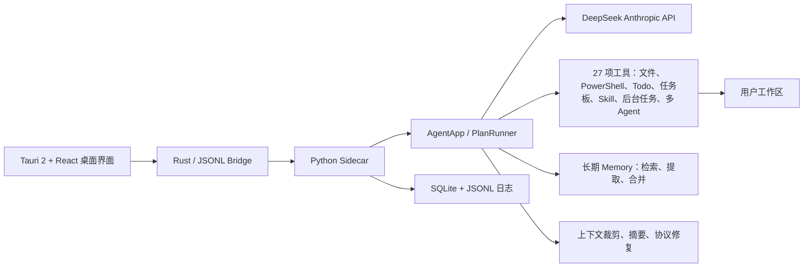

# AstraCode Workbench 产品设计文档

> 文档目的：记录产品想做什么、为什么这样设计、目前完成到哪里，以及下一步优先级。供未来的开发者、用户本人和接手的 AI 阅读。
>
> 当前版本：0.8.1；更新时间：2026-10-11。

## 1. 产品定位

AstraCode Workbench 是一个本地桌面 Coding Agent。用户不需要打开终端，通过自然语言即可让 Agent 查看项目、修改代码、运行命令、制定计划和验证结果。

项目来自 `learn-claude-code` 的 `s_full.py` 思路，但目标已经从教学单文件演进为：

- 可安装、可点击启动的桌面应用；
- 有项目、对话、权限、上下文和日志的长期工作台；
- 能进行真实工程任务，而不仅是展示工具调用循环；
- 结构清晰，方便持续增加功能和由其他 AI 接手。

## 2. 目标用户与场景

主要用户是个人开发者和学习 Coding Agent 架构的开发者。

核心场景：

1. 添加一个本地项目，在项目下创建多个独立对话。
2. 用语言要求 Agent 创建、修改、删除代码和运行测试。
3. 对复杂改动先生成 Plan，审阅后再实施。
4. 在纯聊天模式中对话，必要时临时选择工作目录。
5. 通过权限审批控制跨目录或高风险操作。
6. 出错后直接打开本次日志，快速定位模型、工具或系统问题。
7. 长期保存对话、计划、摘要、日志和项目关系。

## 3. 产品原则

- **本地优先**：项目文件、对话数据库、运行日志和配置保存在本机。
- **行动有证据**：不能只凭模型说“完成了”，必须有与任务匹配的工具成功记录。
- **用户掌控**：允许停止任务、审阅计划、切换权限和查看诊断。
- **渐进暴露复杂度**：普通用户看到聊天界面；工具、日志和高级设置按需展开。
- **可恢复**：中断、截断和非法工具参数不能破坏后续对话。
- **可接手**：重要决策、事故和测试结论必须进入文档。

## 4. 信息架构



界面分为：

- 顶栏：当前项目、调试模式、帮助、设置、sidecar 状态；
- 左栏：项目/纯聊天切换、项目树、对话、置顶/归档/删除；支持平滑收起和 220–420px 拖拽调宽；
- 中间：Markdown 对话、Plan 审阅、可折叠执行记录、输入框；
- 右栏：状态、工具数、权限、Todo 实时进度、子 Agent/Teammate 监视入口、计划和上下文摘要。

## 5. 功能完成情况

状态定义：`完成` 表示已接入并有基础测试；`Beta` 表示可用但仍存在明确边界；`规划中` 表示尚未实现。

| 模块 | 状态 | 当前能力 | 主要后续工作 |
| --- | --- | --- | --- |
| 桌面端 | 完成 | Tauri 2 + React + 冻结 Python sidecar；开发双击启动；Windows NSIS 安装包 | 代码签名、自动更新、macOS/Linux |
| 项目模式 | 完成 | 添加项目路径；项目下多对话；文件工具限制在项目内 | 项目移除、重命名、独立配置 |
| 纯聊天模式 | Beta | 无固定目录；需要文件工作时选择目录 | 更清晰的目录授权历史 |
| 对话持久化 | 完成 | SQLite 保存消息、模型历史、计划、摘要和状态 | 分支、导出、全文搜索 |
| 对话管理 | 完成 | 新建、置顶、归档、恢复、删除 | 手动重命名、批量管理 |
| 自动命名 | 完成 | 首轮通过硅基流动 V4 Flash、关闭思考、48 Token 生成标题；失败回退截取 | 可选本地小模型、手动重新生成 |
| Markdown | 完成 | GFM、表格、代码块、链接 | 代码复制、文件链接定位 |
| 蓝白品牌 UI | 完成 | AstraCode 品牌；浅色/深色蓝白系统；圆角、动效、可收起/调宽侧栏；标题单行渐隐和悬停全文 | 设计令牌拆分、窄屏抽屉 |
| Prompt 模板 | 完成 | 16 个开发与通用模板；含 Todo 分步执行；分类浏览，选中后在大弹窗中编辑，确认后才填入输入框 | 用户自定义模板、收藏和项目级模板 |
| Skill 命令菜单 | 完成 | sidecar 动态读取 Skill；输入 `/` 搜索，选择后强制先调用 `load_skill` | 参数化 Skill、最近使用排序 |
| Agent 工具循环 | Beta | 多轮 model → tool_use → permission → tool_result 循环；27 项工具统一 schema、参数校验和事件追踪 | 动态工具裁剪、流式工具参数、幂等执行 |
| 文件与命令工具 | 完成 | 目录选择、PowerShell、读取、列目录、存在检查、写入、精确编辑和幂等删除共 8 项基础工具 | 真正的进程/文件系统沙箱、批量补丁工具 |
| 持久任务板 | Beta | `task_create/get/update/list/claim_task`；支持负责人、状态、依赖阻塞、完成后解除依赖和删除 | UI 任务板、依赖图、跨会话项目任务 |
| 后台任务 | Beta | `background_run/check_background` 在线程执行命令；完成通知回注主 Agent 上下文 | 重启后重新附着、进程级资源配额、UI 管理 |
| 长期 Memory | Beta | 自动提取 user/feedback/project/reference 记忆；索引、相关性选择、关键词降级、最多 5 条注入、10 条后合并去重 | 用户查看/编辑/禁用、成本控制、专门回归评测 |
| 团队消息协议 | Beta | JSONL 收件箱、点对点消息、广播、读取即清空、关停请求和队友 Plan 审批回执 | 消息确认、重放、冲突解决和 UI 收件箱 |
| 终端兼容入口 | 完成 | 保留 REPL、彩色追踪、`/compact /tasks /team /inbox /permissions /visual` 管理命令 | 与桌面配置完全统一、非交互 CLI |
| 完成判定 | Beta | 按任务要求检查修改/命令/检查证据；识别截断和过程话术 | 内容质量验证、独立 Reviewer |
| 三档权限 | Beta | safe / approval / full_access；主/子/队友复用 | shell 沙箱、Diff 审批、精确授权缓存 |
| Plan 模式 V1 | Beta | 只读调查、结构化计划、批准/修改/取消、执行状态 | 步骤级验收、依赖图、偏差审计 |
| 上下文管理 | Beta | 最近消息、工具结果裁剪、摘要、可恢复原始产物 | 摘要忠实度评测、Token 精确计量 |
| 子 Agent | Beta | Explore/通用子 Agent，共用权限和锁；工作状态、轮次、工具和结果可视化 | 资源配额、取消单个 Agent |
| Teammate | Beta | 队友、消息总线、任务领取、空闲/关闭；支持多成员监视 | 冲突解决、资源配额、单成员控制 |
| Todo 可视化 | 完成 | TodoWrite 成功后实时展示完成比例、当前项和待办项，状态随会话持久化 | Todo 手动编辑和历史对比 |
| Todo 强制模式 | 完成 | 输入框 Todo 按钮显式传递本轮模式；宿主强制先建 3–7 步、仅一项进行、逐项更新并全部关闭，发送后自动复位 | 步骤历史对比、用户中途调整清单 |
| 工作区并发 | 完成 | 单一协调器控制同一时刻的文件/命令访问 | 多工作区并行、读写锁细分 |
| 停止任务 | 完成 | 再次点击发送按钮取消模型和活动命令 | 更细粒度暂停/恢复 |
| Fake Client | 完成 | 离线工具循环和 UI 协议测试 | 录制/回放真实回包 |
| 诊断日志 | 完成 | 会话总日志、每次运行独立日志、异常调用栈 | 隐私遮蔽、日志查看器 |
| 调试模式 | 完成 | 顶栏按钮；任务结束显示“打开日志”；资源管理器定位文件 | 应用内结构化日志分析 |
| 设置 | 完成 | 主题、模型、命名模型、Base URL、Key、命令超时、工具列表 | Provider 管理、导入导出 |
| 独立 Verifier | Beta | 输入框可选关闭/标准/严格；严格模式使用独立上下文和只读工具，失败可定向修复一次 | 评测误报率、按风险自动推荐档位 |
| 修改预览与撤销 | Beta | 每轮文本快照、文件增删改统计、红绿 unified Diff、Markdown 渲染预览、单文件/文件夹入口、冲突保护撤销、失败自动回滚 | 大文件/二进制/图片预览、补丁分块撤销 |
| 可靠任务状态 | Beta | SQLite 运行状态机、工具边界检查点、启动时识别遗留运行、网络中断安全继续、未知工具结果先检查后续跑 | Provider 流续传、后台进程重新附着 |
| 新手引导 | 完成 | 顶栏固定入口；五步缩小版工作台，用高亮框、连线和说明卡指向项目、输入框、任务控制、进度和文件区域 | 首次启动自动展示、可交互示例项目 |
| Windows 下载版 | 完成 | PyInstaller one-file sidecar、Tauri NSIS Setup、SHA-256、GitHub Actions 标签发布 | 商业签名、干净机器矩阵、增量更新 |
| 项目文档与 AI 交接 | 完成 | 完整项目交接入口；分类文档；公开源码导出、使用 README、MIT 来源说明、隐私/贡献/安全文档和离线 CI | 随版本持续校验链接、状态和边界 |

### 5.1 完整能力血缘：原始 `s_full.py` 到 0.8.1

下面的表格是功能盘点的事实来源。`保留并增强` 表示原始单文件已经存在基础实现，0.8.1 对其进行了模块化、桌面化或可靠性加强；不能在简历中写成完全从零原创。

| 能力 | 原始 `s_full.py` | 0.8.1 当前实现 | 状态与边界 |
| --- | --- | --- | --- |
| Agent 事件循环 | 依据 `stop_reason` 在模型与工具之间循环，带轮数/时间上限 | 实际 content block 优先；增加取消、参数校验、重复失败抑制、完成合同、诊断事件 | 保留并增强；仍受模型质量和轮次预算影响 |
| 工具注册与分发 | 23 项工具集中定义在单文件 | 扩为 27 项：保留原 23 项，新增 `set_working_directory/list_directory/path_exists/delete_file`；拆分 schema、handler、permission、executor | 保留并增强 |
| 文件与 Shell | `bash/read_file/write_file/edit_file`，固定启动目录 | 8 项工作区工具，项目/聊天两种路径策略，Windows PowerShell、超时、取消和进程树回收 | 保留并增强；Shell 仍不是 OS 沙箱 |
| Todo | `TodoWrite`、单一进行中校验、未完成提醒 | UI 实时进度；可选强制模式要求 3–7 项、先建清单、逐项关闭，完成门阻止提前结束 | 保留并增强；Todo 是本轮短清单 |
| 持久任务板 | `.tasks/task_<id>.json`；创建、查询、更新、列表、依赖、领取 | `TaskManager` 原子写入会话 runtime；主 Agent/Teammate 可领取，完成后解除其他任务依赖 | 保留并模块化；与 Todo 是两套不同机制 |
| 子 Agent | `Explore/general-purpose` 一次性委派并返回摘要 | Explore 只读、general-purpose 可使用文件工具；复用权限和工作区协调器；UI 显示轮次、工具和结果 | 保留并增强 |
| Skill | 扫描项目 `skills/**/SKILL.md`，按名字注入正文 | 同时扫描应用内置和项目 Skill，项目同名优先；UI 输入 `/` 搜索并要求先调用 `load_skill` | 保留并增强 |
| 上下文压缩 | 旧工具结果 microcompact，超 100k 触发模型摘要，原始 transcript 落盘 | 最近 4 个工具结果完整保留；旧大结果外置并留头尾/路径/哈希；总预算触发结构化摘要并保留近期窗口 | 保留并增强；Token 为近似估算 |
| 后台任务 | 守护线程执行命令，状态查询，通知在下一轮注入 | 复用统一 PowerShell、权限和协调器；结果进入事件和主 Agent 上下文 | 保留并增强；应用重启后不能重新附着旧进程 |
| MessageBus | `.team/inbox/*.jsonl` 点对点、广播、读取清空 | 会话 runtime JSONL，支持 lead/teammate 消息和可观测事件 | 保留并模块化；暂无完整 UI 收件箱 |
| Teammate | 持久身份、角色、工作/空闲/关闭状态，收件箱唤醒，自动领取无阻塞任务 | 复用统一工具执行、权限和工作区协调；多成员监视器展示实时状态 | 保留并增强；“持久”指会话内协作身份，不是跨重启恢复执行线程 |
| 队友关停协议 | 带 request_id 的 shutdown request/response | 关停请求继续通过消息总线传递，状态写入 team 配置和 UI 事件 | 保留；仍缺少单 Agent 强制取消 |
| 队友 Plan 审批 | `plan_approval` 对队友提案返回批准/拒绝 | 继续作为团队消息协议工具存在 | 保留；不要与面向用户的 Plan V1 混为一谈 |
| 面向用户的 Plan | 原版没有独立的桌面 Plan 状态机 | 只读调查、结构化计划、SQLite 版本、批准/修订/取消、批准后受约束执行 | 0.8.x 新增 |
| 长期 Memory | 自动维护 `.memory`；四类记忆、索引、相关检索、任务结束提取、达到阈值后合并 | 独立 `MemoryStore`；每会话 runtime 保存；模型选择最多 5 条相关记忆，失败用关键词降级；完成后提取，10 条起合并 | 原版已有且当前保留；暂无用户管理 UI，额外模型调用有成本 |
| 权限 | deny-list、路径逃逸检查和终端确认 | safe/approval/full_access 风险分级、critical 硬拦截、批准缓存，主/子/队友统一执行入口 | 保留并重构；应用层控制不等于沙箱 |
| 可视化与 REPL | 彩色中文阶段日志，支持 compact/tasks/team/inbox/visual 命令 | CLI 仍保留并新增 permissions；桌面 UI 进一步展示时间线、Todo、Agent、Diff 和日志入口 | 保留并扩展 |
| `s_full_eval.py` 实验 | 为 benchmark 关闭 Memory，增加完成前自测提示、可恢复错误识别和替代路径提示 | 被 CompletionGate、Verifier、结构化恢复状态和真实测试套件替代 | 历史实验已吸收，不作为当前独立运行时 |
| 工作树隔离 | 原文件明确说明 s12 worktree isolation 单独教学，不属于 `s_full.py` | 当前采用单工作区协调器串行访问，没有实现每个 Agent 独立 Git worktree | 未实现；不能对外宣称已具备 worktree 隔离 |

### 5.2 当前 27 项工具清单

- **工作区（8）**：`set_working_directory`、`bash`、`read_file`、`list_directory`、`path_exists`、`write_file`、`edit_file`、`delete_file`。
- **短任务与能力加载（4）**：`TodoWrite`、`task`、`load_skill`、`compress`。
- **后台执行（2）**：`background_run`、`check_background`。
- **持久任务板（4）**：`task_create`、`task_get`、`task_update`、`task_list`；领取由下方 `claim_task` 完成。
- **团队协作（9）**：`spawn_teammate`、`list_teammates`、`send_message`、`read_inbox`、`broadcast`、`shutdown_request`、`plan_approval`、`idle`、`claim_task`。

Memory 不是显式工具，而是宿主自动生命周期：模型调用前选择并注入相关记忆，任务成功结束后提取耐久信息，数量达到阈值后合并去重。

## 6. 关键交互设计

### 6.1 一次任务

1. 用户发送消息。
2. UI 创建请求 ID，清空本轮执行记录，显示运行中。
3. sidecar 记录用户消息和运行日志路径。
4. 首轮对话生成短标题。
5. Agent 调用模型和工具，权限引擎逐次判断。
6. 完成门检查实际证据。
7. 事务生成本轮文件清单、行数和 Diff。
8. 按用户选择运行独立 Verifier；严格模式可触发一次定向修复和复验。
9. UI 收到完成、验证失败、未完成、取消、中断或错误状态；失败按设置回滚。
10. 调试模式开启时，执行记录末尾显示“打开日志”。
11. 如果本轮产生文本文件，完成卡片允许直接预览内容、切换 Diff、打开单文件位置或文件夹。

### 6.8 文件预览与新手引导

- 用户界面统一使用“本轮文件”和“打开文件夹”，不再使用偏工程化的“产物”称呼；删除文件仍保留在完整 Diff 清单中。
- `.md` / `.markdown` 默认使用与聊天消息一致的安全 GFM 渲染；其他文本显示等宽纯文本；用户可随时切换到 unified Diff。
- 预览使用任务完成时的事务快照，明确提示它不是磁盘实时编辑器；资源管理器入口用于查看最新文件。
- Rust 打开目录命令会先规范化项目根目录，并拒绝跳出根目录的相对路径。
- “新手指南”和“工具手册”分离：前者使用五页可视化导览，用缩小版真实工作台、高亮框和箭头说明关键区域；后者负责完整工具与 Prompt 示例。
- Markdown 代码区域使用主题变量：浅色主题为浅灰蓝背景和深色代码，深色主题为深蓝背景和浅色代码，行内代码与块级代码分别处理。
- 发布版不携带开发者 Key。用户配置写入 `%LOCALAPPDATA%\AstraCode\config.env`，项目目录中的旧 `.env` 仅作为开发兼容回退。

### 6.5 Verifier、修改卡片与安全继续

- `不验证`：不增加模型调用，适合纯问答和低风险小任务；CompletionGate 仍然生效。
- `标准验证`：独立模型仅根据需求、最终答复、变更集和工具证据做一次结构化判断。
- `严格验证`：独立模型可使用 `read_file`、`list_directory`、`path_exists` 只读检查；发现明确问题时主 Agent 最多定向修复一次，再独立复验。
- 每轮任务在首次可能写入前拍摄文本快照，结束后显示新增/修改/删除、增加/删除行数、红绿 Diff 和最终文本。
- 撤销会恢复修改/删除文件并移除本轮新增文件；若文件在任务后又被手动改过，拒绝覆盖并报告冲突。
- 网络、超时、429、502/503/504 等暂时性故障保留现场并标记为可恢复；继续时带入可靠检查点，先检查“结果未知”的工具，而不是重复执行。

### 6.6 Prompt 模板编辑

- 点击输入框下方“模板”后，先在弹窗内按开发、排障、文档、协作、学习、写作、分析、规划分类浏览。
- 选择模板不会立即覆盖当前输入；弹窗原地切换为大文本编辑器并自动聚焦。
- 用户可以在大编辑器中补充目标、材料和约束；点击“确认填入”后才写入主输入框。
- `Esc` 在编辑态返回模板列表，在列表态关闭弹窗；也支持明确的返回、取消和关闭按钮。
- 内置模板包括代码实现、排障、技术文档、代码审查、子 Agent/Teammate、后台任务，以及学习路线、概念讲解、文章写作、润色、决策分析、材料摘要、项目计划和会议纪要。
- “Todo 分步执行”模板要求先建立 3–7 个 Todo，再依次执行实际工具并更新清单，明确 TodoWrite 不能代替文件和命令操作。

### 6.7 Todo 快捷模式与紧凑验证提示

- 输入框工具栏提供 `Todo` 切换按钮；开启时高亮并通过 `aria-pressed` 暴露状态。
- 发送时将 Todo 执行合同加入仅供模型使用的任务指令；对话中仍只保存用户原始文本。
- Todo 合同要求先拆 3–7 个可验证步骤、同一时间仅一个 `in_progress`、每步完成立即更新，并明确清单不能代替实际工作。
- UI 同时向 sidecar 传递显式 `todo_mode`，运行配置和恢复记录会保留该值；任务合同分析前会移除宿主控制块，只判断真正的用户任务。
- 宿主会拒绝在首个有效 `TodoWrite` 前执行其他任务工具；清单不足 3 项、超过 7 项或进行中数量不合法时要求模型修正。
- 只要清单尚未建立或仍有未完成项，纯文本回包不能结束任务；Todo 模式最大轮次下限提升为 16，满足逐步工作与状态更新的交替调用。
- 按钮属于单次任务设置，发送后自动关闭，避免无意影响下一轮。
- 独立验证不再占用大卡片：默认折叠成约 28px 的单行提示，只显示结论和模式；点击后查看完整摘要与问题。

### 6.2 自动命名

- 只在对话第一条用户消息时调用一次。
- 默认模型：硅基流动 `deepseek-ai/DeepSeek-V4-Flash`。
- 使用独立的 OpenAI-compatible Base URL 和 API Key，与主 Agent 的 DeepSeek Anthropic-compatible 配置隔离。
- 强制关闭思考，不提供工具，最多输出 48 Token。
- 输出清理 Markdown、引号、标签和句号。
- API 失败时使用首条消息的稳定短标题，不能影响主任务。
- `S_FULL_TITLE_MODEL`、`S_FULL_TITLE_BASE_URL`、`S_FULL_TITLE_API_KEY` 可独立更换命名供应商，不会覆盖主任务配置。

### 6.3 调试模式

- 顶栏 `调试 OFF/ON` 按钮，使用 `aria-pressed`，状态保存在 localStorage。
- 关闭时隐藏冗长日志路径，不干扰普通使用。
- 开启后，任务结束区域显示日志绝对路径和“打开日志”。
- Rust 只接受 `%LOCALAPPDATA%\s_full\sessions` 下已经存在的路径。
- Windows 资源管理器打开父文件夹并选中本次 `.jsonl`。

### 6.4 Plan 模式

- 计划阶段只暴露只读工具。
- 输出结构包括标题、摘要、假设、步骤、文件、验证和风险。
- 用户可批准、要求修改或取消。
- 批准后生成执行约束，进入正常 Agent 与权限系统。

## 7. 数据设计

主数据库：

```text
%LOCALAPPDATA%\s_full\index.sqlite
```

核心表：

- `projects`：项目路径和名称；
- `sessions`：对话标题、工作空间、状态、置顶、归档、摘要；
- `messages`：用户可见消息；
- `model_state`：交给模型的完整结构化历史；
- `plans`：计划版本和状态；
- `events`：结构化事件索引。
- `runs`：每次请求的状态、阶段、配置、工具检查点、变更集、验证结论和恢复标记。

运行日志：

```text
%LOCALAPPDATA%\s_full\sessions\<session-id>\events.jsonl
%LOCALAPPDATA%\s_full\sessions\<session-id>\runs\<request-id>.jsonl
```

原版机制在桌面版中的会话级运行数据：

```text
%LOCALAPPDATA%\s_full\sessions\<session-id>\runtime\.memory\      # 长期记忆及 MEMORY.md 索引
%LOCALAPPDATA%\s_full\sessions\<session-id>\runtime\.tasks\       # 持久任务板 JSON
%LOCALAPPDATA%\s_full\sessions\<session-id>\runtime\.team\        # 队友配置与 JSONL 收件箱
%LOCALAPPDATA%\s_full\sessions\<session-id>\runtime\.transcripts\ # 压缩前原始上下文和工具结果 artifact
```

这些目录由 `state_root` 指向应用数据区，不再默认写入用户项目。Memory 和任务板目前以“单个对话”为隔离边界；SQLite 的 `model_state` 则保存交给模型的结构化对话历史，两者用途不同。

## 8. 已确定的重要产品决策

1. 桌面技术栈选择 Tauri 2 + React，Python 作为 sidecar，保留 Agent 核心开发效率。
2. 使用 Anthropic 兼容协议接入 DeepSeek，以正确回传 thinking 和 tool-use 消息。
3. 项目运行元数据移出用户项目，避免 `.tasks/.team/.memory` 污染工作区。
4. 对话可见消息和模型历史分开保存，便于 UI 与上下文压缩独立演进。
5. 任务完成不能只信 `stop_reason`，必须结合工具证据。
6. 工具消息链在调用前、保存前自动修复，取消也必须产生对应结果。
7. 自动命名不使用主任务的高思考配置，避免不必要成本和延迟。
8. 调试日志入口由 Tauri 受限命令打开，不允许任意路径启动。
9. 所有开发相关任务完成前必须同步更新 `docs/project_docs/product/PRODUCT_DESIGN.md` 与 `docs/project_docs/product/PRODUCT_DEVELOPMENT.md`；该规则同时写入项目 `AGENTS.md` 和 `.memory`。
10. Verifier 与主 Agent 分离：主 Agent 负责实施，Verifier 只读检查证据并给出通过、需修复或无法验证。
11. 文件撤销以“本轮事务快照”为边界，不用 Git reset 覆盖用户原有未提交修改。
12. 恢复机制以持久化运行状态和工具检查点为依据，不能盲目重放可能产生副作用的工具。
13. 用户主动取消保留现场并允许继续，不自动回滚；确定性任务失败默认回滚；网络类暂时失败保留改动等待安全继续。
14. 宿主生成的执行要求不能参与用户意图判定；Todo 强制模式必须通过显式运行参数和状态机实现，提示词只负责指导模型。
15. 可见品牌、包名和应用标识统一使用 AstraCode；`%LOCALAPPDATA%\s_full` 数据目录暂时保留，避免升级时丢失既有会话和日志。
16. 可下载版本必须使用独立干净 Python 虚拟环境构建，安装包与冻结 sidecar 都要进行凭据特征扫描，并发布 SHA-256。
17. 原版 Todo、任务板、Memory、Skill、后台任务、MessageBus、Subagent 和 Teammate 均继续保留；文档必须明确“继承后增强”而不是遗漏或宣称从零原创。
18. Todo 用于本轮短清单，TaskManager 用于带 ID、负责人和依赖关系的持久任务板，两者不互相替代。
19. 用户 Plan V1 与 `plan_approval` 是两套机制：前者是桌面端“调查—审阅—执行”状态机，后者是 Teammate 消息协议中的计划回执。
20. Memory 默认按会话隔离并自动运行，检索、提取或合并失败不能影响主任务；未来提供 UI 开关前，应在文档中明确其额外模型调用和信息保留边界。

## 9. 路线图

### P0：可靠性与安全

- Diff 预览、应用与一键回滚；
- 真正的 shell 目录/进程沙箱；
- 崩溃后任务恢复和工具幂等；
- 日志凭据遮蔽；
- 独立结果验证器。

### P1：Agent 质量

- Plan 步骤级进度和验收；
- 自动测试选择和失败归因；
- 上下文摘要忠实度评测；
- 文件变更清单和最终交付卡片；
- 子 Agent/Teammate 可视化。
- Memory 查看、编辑、删除、禁用和项目级共享策略；
- 持久任务板 UI、依赖图和 Todo/Task 转换；
- 后台任务重启附着与资源配额；

### P2：产品化

- Windows 安装包已完成；继续补签名和自动更新；
- OS Keychain 保存凭据；
- 对话搜索、导出、分支；
- 多 Provider 和模型能力探测；
- 内置日志查看器和诊断包导出。

## 10. 未来修改本产品时的规则

每次新增功能或修复事故，至少更新：

1. 本文的功能状态或产品决策；
2. [`PRODUCT_DEVELOPMENT.md`](PRODUCT_DEVELOPMENT.md) 的问题与修复记录；
3. 对应自动化测试；
4. 如果涉及真实模型协议，增加一次真实 API 烟雾测试；
5. 如果涉及权限，更新 [`PERMISSION_BOUNDARIES.md`](../architecture/PERMISSION_BOUNDARIES.md)。
